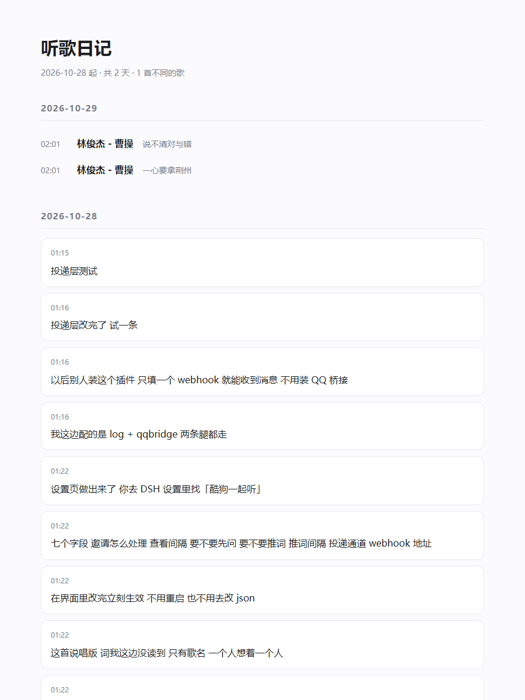

# 酷狗一起听（dsh-kugou-listen）

让 AI 知道你在听什么、唱到哪一句，还能一起听、能真的听、能控播放。

给 [DeepSeek Harness](https://github.com/deepseek-ai) 用的插件。**Windows 专用。**

**当前版本：1.0.13 ｜ 只在酷狗 20.0.41 上完整验证过。**

> 别的版本可能不行，尤其 20.1.x（Chromium 内核）。原因写在
> [这份记录](docs/chromium-a11y.md) 里：
> Chromium 系程序默认不把网页内容交给系统无障碍接口，按控件名点按钮这条路会失效。
> 读歌、读歌词不受影响。

> 第一次装，先跑 `setup.ps1`，它会检查依赖并把配置里的路径写对。
> 不想跑脚本也行，见下面「手动装」。

---

## 它做什么

| 能力 | 说明 |
|---|---|
| 读歌 | 现在在放什么、在不在放（这俩不用截图） |
| 读词 | 屏幕上看得见的歌词行 |
| 听一段 | 录系统声音交给多模态模型，听出歌词里没有的东西：怎么唱的、快慢、乐器、紧还是松 |
| 一起听 | 接住别人发来的一起听邀请；也能自己开房把链接发出去 |
| 会说话 | 到点自己醒过来，看一眼在放什么，说一句自己的话，投递到你能看见的地方 |
| 控播放 | 暂停/继续、上一首、下一首（媒体键，不动鼠标） |

---

## 装之前先看这几条

1. **只认 Windows 上的酷狗桌面版。** 手机端、网页版、网易云都不在这条路上。
2. **酷狗窗口不要最小化。** 最小化可能抓到黑图。
3. **歌词要停在歌曲页的「歌词」标签。** 停在歌单或搜索页时只读得到歌名。
4. **认默认皮肤和默认布局。** 换皮肤、改字号、改窗口比例，可能切歪。
5. **屏幕缩放不是 100% 时坐标可能偏**，自检会给结论。
6. 读的是**屏幕画面**（音频只在开了「听力」时用）。屏幕上盖别的窗口没关系，但酷狗必须真的在放。
7. **开房、邀请、退出房间都能做**，走 UI 自动化按控件名字点按钮（需要 `uiautomation`，见装法）。歌词以外的操作都不靠截图。
8. **改过设置要重启一次 DSH** 才认新字段，刷新页面不够。
9. 读不到就点「自检」，它会说卡在哪一步。

---

## 装

### 一、依赖

**一条命令**（把引号里的 python 换成你机器上那个就行）：

```
pip install pillow numpy winocr pyaudiowpatch uiautomation "mcp<2"
```

国内慢就加镜像：

```
pip install pillow numpy winocr pyaudiowpatch uiautomation "mcp<2" -i https://pypi.tuna.tsinghua.edu.cn/simple
```

也可以 `pip install -r requirements.txt`，内容是一样的。

两个容易踩的点：

- `mcp` 必须是 **1.x** —— 2.x 把 `FastMCP` 改名了，脚本会起不来。上面那条 `"mcp<2"` 已经锁住了。
- `uiautomation` 来自 PyPI（https://pypi.org/project/uiautomation/），Apache 2.0，会顺带装上 comtypes。**它只认「用哪个 python 装的」**，装在哪个目录、是不是虚拟环境都无所谓——只要跑插件的那个 python 能 `import uiautomation` 就行。

`uiautomation` 装了之后：开房、邀请好友、退出房间这些「要按按钮」的事，走系统的 UI Automation，按控件名字点，不截图、不算坐标，十秒内完成。不装也能读歌读词，但那些功能会退回截图认字，慢且容易点空。

**不想敲命令也行**：装好插件、重启 DSH 之后，设置页里点「检查依赖」，缺 `uiautomation` 会直接出现一个 **「去下载 uiautomation」** 按钮（跳到 PyPI），旁边还有「复制安装命令」，复制出来粘到命令行就跑。

### ⚠️ 还要有 Windows 的**中文 OCR 语言包**

这套的读词全靠 Windows 自带的 OCR。**英文系统或精简版 Windows 上经常没有中文识别包**，那时候只能读到歌名、读不到歌词。

装法：设置 → 时间和语言 → 语言和区域 → 添加「中文(简体)」→ 语言选项里勾上「光学字符识别」。

`--deps` 会直接告诉你有没有（看 `ocr_chinese` 和 `ocr_languages` 两项）。

### 装完先体检

```
python tools/kugou_mcp.py --deps
```

它会逐个报：python 版本、五个包、mcp 版本、**系统 OCR 有哪些语言**、平台对不对。缺什么就给对应的命令。

### 二、跑 setup.ps1（推荐）

在这个目录里：

```
powershell -ExecutionPolicy Bypass -File .\setup.ps1
```

用 venv 的话：

```
powershell -ExecutionPolicy Bypass -File .\setup.ps1 -Python "C:\你的\venv\Scripts\python.exe"
```

它做三件事：找 python → 体检依赖 → 把 `cordis.patch.yml` 里的 `command` 和 `args` 改成这台机器的真实路径。

### 三、手动装（不想跑脚本）

打开 `cordis.patch.yml`，把这两行改成你的：

```yaml
        command: python                      # ← 你的 python 完整路径更保险
        args:
          - ./tools/kugou_mcp.py             # ← 这个文件的完整路径
```

### 四、装进 DSH

用插件管理器的「本地目录安装」指向这个文件夹，或者：

```
dsh plugin --profile <你的 profile> add link:<这个目录的绝对路径>
```

**装完重启一次 DSH。** 重启后设置左侧栏最下面会有「酷狗一起听」。

### 五、让它真的开口（新建定时）

插件自己不会说话：说话要调模型，得靠 DSH 的定时任务来跑。装好之后对 Ta 说一句就行，设置页里也放了一句可以直接复制的：

> 从现在起，每 10 分钟看一眼酷狗在放什么（用 kugou_now）。没在放歌就什么都不发。换歌了可以用 kugou_hear 听一小段当材料，然后说一句你自己的想法，用 kugou_say 发给我。不许提模型、不许写「旋律很美」、不许重复、不带句号。把这套做成定时任务。

（每分钟一次＝一天约 1440 次模型调用，5 分钟约 288 次，自行取舍。）

### 六、让它闭嘴（不想听的时候）

两种办法：

- 设置页关掉「Ta 的听歌想法推送间隔」那个开关 —— 定时还在跑，但每轮开头 `--tick` 会返回 `speak: false`，一个字都不发
- 直接让 Ta 删掉那个定时任务

没有歌在播的时候，Ta 可能会给你发一条空消息（定时照样会跑一轮）。不喜欢就对 Ta 说：关闭查看酷狗音乐的自动任务。

---

## 设置页那几项

| 项 | 作用 | 默认 |
|---|---|---|
| 邀请怎么处理 | `ask` 先问 / `auto` 看到就接 / `off` 不管 | ask |
| 隔多少秒看一眼 | 扫邀请的间隔；左边勾选框是这一路的总开关 | 15 秒，开 |
| 看到邀请先发消息问 | 弹提醒，而不是直接接 | 开 |
| 把歌词一句句推出去 | 会吵，默认关 | 关 |
| 推词最小间隔 | 上一条生效时的最小间隔 | 90 秒 |
| 投递通道 | `log` / `webhook` / `qqbridge`，可多选 | 只有 log |
| webhook 地址 | Bark、钉钉、Telegram、飞书都吃 JSON | 空 |
| **QQ 收件人** | 选 `qqbridge` 时填收件人的 QQ 号；不填会明确报「没配收件人」 | 空 |
| Ta 的听歌想法推送间隔 | Ta 多久冒一次话（不是推歌词）；填几就是几分钟 | 10 分钟 |
| 开启真正的听力能力 | 录音 → 多模态模型；会让感想慢一拍 | 关 |
| API Key / API URL / 模型选择 | 兼容 DashScope 原生接口与 OpenAI 兼容接口 | 空 / qwen-audio-turbo |


---

## 投递：默认不需要任何外部服务

- **log**：写 `~/.kugou-listen/listening.log`，永远可用
- **webhook**：POST 一段 JSON（`text` / `content` / `msg` / `title` / `body` 都带上了，各家自己认哪个都行）
- **qqbridge**：本机 qq-bridge 的 `/api/send/private`，需要装那个东西，并在设置里填「QQ 收件人」；没配会明确告诉你缺收件人，不会静默失败

**推荐 webhook**，不依赖 QQ，也不用守着屏幕。

桥接那几个值可以用环境变量改（设置页优先）：

```
KUGOU_BRIDGE_URL     默认 http://127.0.0.1:3100
KUGOU_BRIDGE_TOKEN   默认 ~/qq-bridge/state/console-token
KUGOU_OWNER_QQ       收件人 QQ；设置页里的「QQ 收件人」优先于它
```

---

## 顺带做的：听歌日记

插件会顺手记下在听什么（每首歌一行，存在 `~/.kugou-listen/history.jsonl`）。
`工具/听歌日记.py` 把它渲染成一张按天排的页面，纯本机、不联网：

```
python 工具/听歌日记.py
# 输出 HTML，双击就能看
```


## 命令行

MCP 那条路偶尔会卡（客户端夹在两个 server 之间），所以这些都做成了命令行：

```
python tools/kugou_mcp.py --deps          # 体检依赖
python tools/kugou_mcp.py --selfcheck     # 体检能不能读到酷狗
python tools/kugou_mcp.py --tick          # 定时轮开头用：这一轮该不该开口（含开关判断）
python tools/kugou_mcp.py --report        # 出一份诊断报告（跑不通就贴这个）
python tools/kugou_mcp.py --once          # 读一次：歌名 / 在不在放 / 歌词
python tools/kugou_mcp.py --hear 15       # 录 15 秒让模型听
python tools/kugou_mcp.py --say "文本"    # 投递一段话
python tools/kugou_mcp.py --pause         # 暂停/继续
python tools/kugou_mcp.py --next          # 下一首
python tools/kugou_mcp.py --prev          # 上一首
python tools/kugou_mcp.py --invite        # 开房，把邀请链接放到剪贴板
python tools/kugou_mcp.py --exit          # 退出一起听房间（含确认框）
```

`--tick` 的输出里有 `speak`：关掉「听歌感想」、没在放歌、读不到歌名，它都是 false。定时任务看到 false 就该闭嘴——这样那个开关才真的有用。

---

## 原理（给想改的人）

一开始以为酷狗什么接口都没有，只能截图。后来发现两件事：

**一、它其实暴露了 UI Automation。** 控件名字都是现成的：「更多」「一起听」「邀请好友一起听」「复制链接」「退出」「再听一会」「上一首」「播放」。所以：

- 读歌名、时间 → 读控件文字（不截图）
- 点按钮 → `uiautomation` 按名字找控件，调它的 Click（不截图、不算坐标、不看前台）
- 声音 → 媒体键（不动鼠标）

**二、只有歌词必须截图。** 歌词是画在画布上的，没有控件。所以：

1. **PrintWindow** 把窗口自己渲染成图（不怕被别的窗口盖住），偶发失败重试三次 + 屏幕兜底
2. **Windows 自带 OCR**（zh-Hans）认字
3. **歌词区不用写死的比例**：先整窗认一次字，把「像歌词」的行（中文为主、2–30 字、不含版权词和时间）按行距聚成一簇，取那一簇的包围盒当歌词区，按窗口尺寸缓存起来。缓存读空两次就自动作废、重新认。认不出来才退回比例裁切（宽 54%–94%、高 64%–90%）。灰度 + 自动对比度 + 放大两倍再 OCR。
4. **在不在放**不靠标题（标题会停在上一首），靠连抓两帧数「变了多少像素」

不能用的路（都试过）：SMTC 不登记（0 个会话）、本地端口 8860/8861/8878/8879 只回 404。

踩过的坑都写在代码注释里，比如「接受」出现在歌词里会被误判成邀请按钮、OCR 把「04:53」读成「0453」。

---

## 跑不通怎么办

这套东西只在作者的机器上完整验过。换一台电脑，可能踩到这些：屏幕缩放不是 100%、酷狗版本不同、系统没有中文 OCR 语言包、Python 版本不同、多个显示器。

所以别猜，让它自己说。按顺序跑两条：

```
python tools/kugou_mcp.py --deps
python tools/kugou_mcp.py --report
```

第一条告诉你缺什么依赖。第二条出一份完整报告：系统版本、Python 路径、依赖版本、屏幕尺寸和 DPI、找到几个酷狗窗口（多大、标题）、能不能读到歌、设置和最近扫描日志。

**把 `--report` 的输出整段贴回来**，基本就不用再来回问「你什么系统」「窗口多大」这些问题了。

---

## 已知限制

- 只有 Windows
- 歌词区是自动认的（会按窗口尺寸各自校准），但极端皮肤/超大字号仍可能认偏，那时看 --report 里的窗口尺寸
- 没装 `uiautomation` 时，开房/退出会退回截图认字，慢且可能点空
- 一台机器跑多个实例会争 OCR，建议只留一个
- 录音在没有声音时会阻塞，已加超时放弃（约 20 秒给结论）
- 退出房间时如果你正好在动鼠标，可能点空，重试一次即可
- 插件不会自己建定时任务（宿主没给插件这个口子），要靠你对 Ta 说一句话
- 酷狗弹「该歌曲已失败多次」这种提示框时，读不到歌名，那几轮会静默

---

## 制作

**拾（其实是 DeepSeek）** 负责代码编写、**坠雨已辞云** 提供辅助。

问题反馈请加 QQ：**2876164958**（坠雨已辞云）

MIT 许可。
